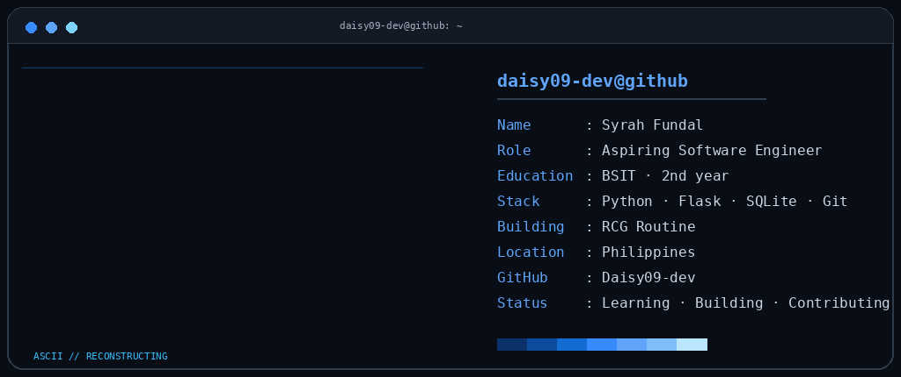
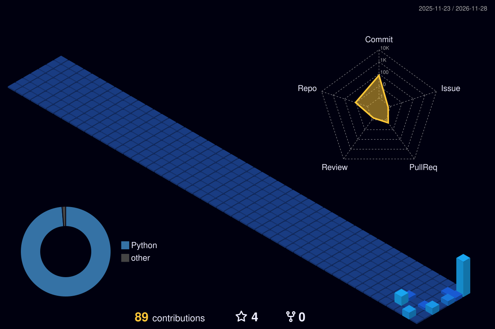

[**Try the cursor-reactive ASCII portrait ↗**](https://daisy09-dev.github.io/Daisy09-dev/) · Move your mouse over the face—no clicks needed once opened.\n\n### Aspiring Software Engineer · Building with purpose

**BS Information Technology Student · Python & Web Development · Open-Source Enthusiast**

---

### About me

I'm a second-year BSIT student who enjoys turning everyday challenges into practical software. I'm focused on strengthening my programming fundamentals, building useful applications, and learning how to ship maintainable projects.

- **Currently exploring:** Python, Flask, SQLite, JavaScript, and software design
- **How I work:** Prototype → test → improve → document
- **What matters:** Clear interfaces, useful features, and consistent learning

### Credentials & community

**WordPress community involvement**

Participated in WordCamp Philippines 2026 and explored open-source collaboration through WordPress community activities.

**Making WordPress community**

- Participated in WordCamp community activities, including Contribution Day and Training/Community Team sessions.
- Connected with the **Making WordPress #training** Slack community to learn about documentation, onboarding, and open-source collaboration.
- WordPress.org username: [**syrah44**](https://profiles.wordpress.org/syrah44/) *(profile link; activity and roles should be checked on WordPress.org)*.

*Community participation is not presented as employment, an official team appointment, or completed training certification.*

### Client collaboration

I build and improve small applications, prototypes, and practical software tools. I'm interested in opportunities involving **Python automation, simple web applications, front-end interfaces, documentation, and technical support**.

**Explore my work:** [GitHub projects](https://github.com/Daisy09-dev?tab=repositories) · **Connect professionally:** [LinkedIn](https://www.linkedin.com/in/syrah-fundal-848396309/) · **WordPress community:** [WordPress.org](https://profiles.wordpress.org/syrah44/)

### Tech stack

**Languages & tools**

**Web & data**

### Selected work

| Project | Focus |
| :--- | :--- |
| **[DAISY09 Terminal](./terminal/README.md)** | Python terminal animation featuring Chinese-character rain and a typography capybara |
| **RCG Routine** | Personal daily execution system built with Flask and SQLite; work in progress |
| **[Browse my repositories](https://github.com/Daisy09-dev?tab=repositories)** | Coursework, experiments, and ongoing software projects |

### Skills & technologies

**Explore what I've built:** [Projects and repositories](https://github.com/Daisy09-dev?tab=repositories) · [DAISY09 terminal source](./terminal/fullscreen.py)

### Developer dashboard · live GitHub data

*These cards request real GitHub data from a third-party rendering service. Statistics may be cached or exclude private contributions.*

### Contribution Breakout · sky-blue arcade

<picture>
  <source media="(prefers-color-scheme: dark)" srcset="./breakout/dark.svg">
  
</picture>

*Generated by [GitHub Breakout](https://github.com/cyprieng/github-breakout) from recorded contribution dates. The image appears after its first successful workflow run.*

### Coding time · WakaTime

Coding time is shown only after WakaTime is connected to an editor and its GitHub integration is enabled.

<!--START_SECTION:waka-->
<!--END_SECTION:waka-->

[Set up WakaTime](https://wakatime.com/) · [Coding activity workflow](./.github/workflows/wakatime-activity.yml)

### Advanced developer metrics

[Advanced GitHub Metrics](https://github.com/lowlighter/metrics) is configured as an **opt-in** integration. It will display verified activity and language metrics after a GitHub token is configured and the workflow is enabled.

[Metrics workflow](./.github/workflows/advanced-metrics.yml)

### 3D contribution skyline

3D activity visualization · Generated from real contribution records · Updated daily

### Contribution activity

<picture>
  <source media="(prefers-color-scheme: dark)" srcset="https://raw.githubusercontent.com/Daisy09-dev/Daisy09-dev/output/github-snake-dark.svg">
  
</picture>

Sky-blue snake generated from recorded GitHub contributions and refreshed by GitHub Actions.

For the exact contribution calendar and dates, [view my live GitHub activity](https://github.com/Daisy09-dev?tab=overview).

---

**Learning continuously. Building intentionally.**

DAISY09 · Made with curiosity and code

