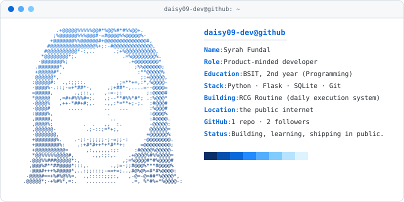

<picture>
  <source media="(prefers-color-scheme: dark)" srcset="neofetch-dark.svg">
  
</picture>

## About

2nd year BSIT student majoring in Programming. I like turning real daily problems into small, useful systems, then improving them one step at a time.

## Currently

- Building **RCG Routine**, a personal daily execution system (Flask + SQLite)
- Learning to design before coding, and to ship small things consistently

## Toolbox

## Activity

<picture>
  <source media="(prefers-color-scheme: dark)" srcset="https://raw.githubusercontent.com/daisy09-dev/Daisy09-dev/output/github-snake-dark.svg">
  
</picture>

Card and snake refresh automatically every day with GitHub Actions.

