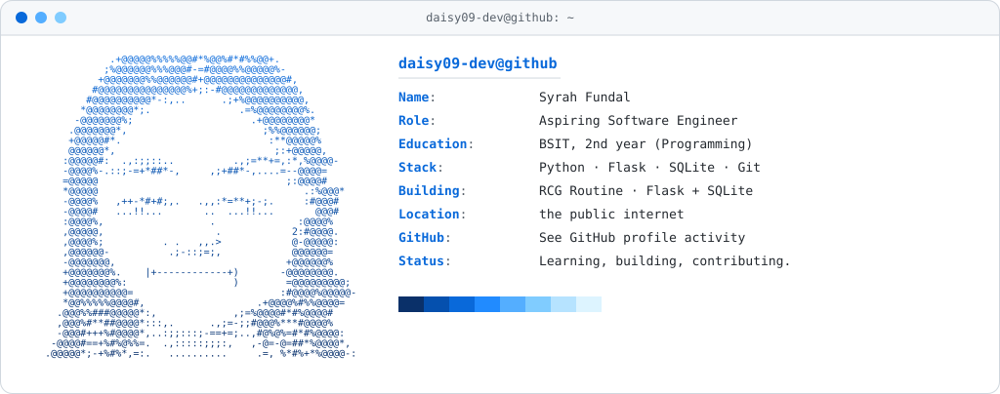
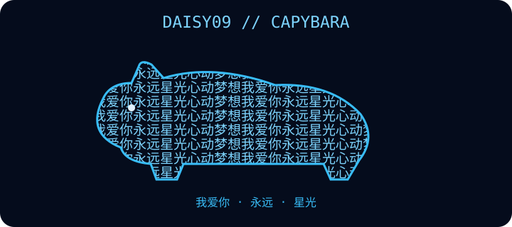

<div align="center">

<picture>
  <source media="(prefers-color-scheme: dark)" srcset="neofetch-dark.svg">
  
</picture>

### Building useful things, one commit at a time.

**BSIT student · Python developer · Learning by shipping**

[](https://github.com/Daisy09-dev)
[](https://github.com/Daisy09-dev?tab=overview)

</div>

## About

I'm a second-year BSIT student focused on programming and building practical tools. I enjoy turning everyday problems into small, useful systems and improving them through experimentation.

## Currently building

- **RCG Routine** — a personal daily execution system using Flask and SQLite
- **DAISY09 Terminal** — a neon-blue Chinese typography animation with a rotating capybara
- Stronger foundations in programming, version control, and software design

## Tech toolbox


## Contributions · actual GitHub dates

My contribution activity is recorded by GitHub itself. The calendar on my [public profile](https://github.com/Daisy09-dev?tab=overview) reflects qualifying contributions on their recorded dates, including any private contributions I have chosen to display.

[**View my live contribution calendar and activity →**](https://github.com/Daisy09-dev?tab=overview)

*No manually generated or invented contribution dates.*

<!-- DAISY09 PROJECT START -->
## Featured project · DAISY09 Cyberpunk Terminal

A macOS Terminal experience combining full-screen neon-blue Chinese character rain with a rotating capybara formed from Chinese typography.

<div align="center">



</div>

**Python · macOS · Terminal animation · Unicode**

[**Explore the terminal project →**](terminal/README.md) · [**View the animation source →**](terminal/fullscreen.py)

To run it locally:

```bash
python3 terminal/fullscreen.py
```

To repeat the animation:

```bash
while true; do python3 terminal/fullscreen.py; done
```

Stop with **Control + C**.

<!-- DAISY09 PROJECT END -->
