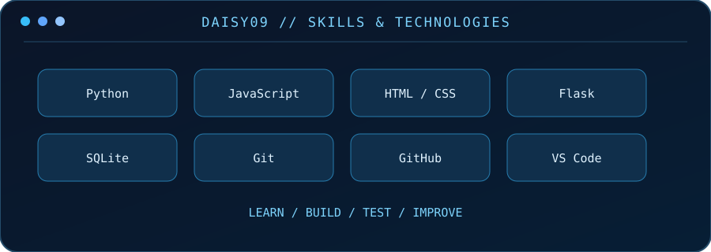

# DAISY09

### Syrah Fundal · BS Information Technology

**Build useful things. Learn by doing. Document the journey.**

---

## About me

I'm a second-year BS Information Technology student in the Philippines, developing practical skills through coursework, personal experiments, and collaborative projects. I enjoy building interactive applications, understanding how systems work, and improving software through feedback and documentation.

My current focus is **web development, Python applications, databases, and software design**. I'm also exploring real-time browser interactions and open-source collaboration.

## Featured project — ROAD RUSH

**An educational 3D endless runner that combines arcade gameplay with road-safety learning.**

Adapted from the open-source Subway Rush project, ROAD RUSH explores difficulty-based quizzes, motorcycle pursuit, animated meme-style obstacle attacks, synthesized audio, and peer-to-peer multiplayer rooms.

**Stack:** JavaScript · Three.js · Web Audio API · PeerJS · Vercel

> AI-assisted educational prototype. Quiz content is unofficial; multiplayer and device-level gameplay still require verification. The development record explains implementation decisions and limitations.

## Selected work

| Project | What I explored | Technologies |
| :--- | :--- | :--- |
| [StudyCoach](https://github.com/Daisy09-dev/StudyCoach) | Study routines, equation-based timers and session tracking | JavaScript, Node.js |
| [Study Timer App](https://github.com/Daisy09-dev/study_timer_App) | Collaborative desktop productivity application, OOP and layered design | Python, Tkinter, SQLite |
| [Sign Language Study System](https://github.com/Daisy09-dev/SignLanguageStudySystem) | Learning modules, webcam practice and progress tracking | Flask, SQLite, OpenCV |
| [Student Management System](https://github.com/Daisy09-dev/student-management-system-tkinter) | CRUD operations, validation and file persistence | Python, Tkinter |
| [Web Quiz Collection](https://github.com/Daisy09-dev/web-quiz-collection) | Interactive programming quizzes and immediate feedback | HTML, CSS, JavaScript |
| [DAISY09 Terminal](./terminal/README.md) | Personalized terminal animation and creative coding | Python, shell |

[Browse all repositories →](https://github.com/Daisy09-dev?tab=repositories)

## Technical toolkit

**Practicing:** Object-oriented programming · CRUD · REST integration · Git workflows · UI development · Technical documentation

**Exploring:** Real-time networking · Computer vision · Software architecture · Deployment

## Community & collaboration

I participated in WordCamp Philippines 2026, including Contribution Day and WordPress Training/Community Team activities. I'm interested in contributing to open-source projects, learning from other developers, and making technical information easier to understand.

[WordPress profile](https://profiles.wordpress.org/syrah44/) · [LinkedIn](https://www.linkedin.com/in/syrah-fundal-848396309/)

## Creative corner

[Explore my interactive ASCII portrait ↗](https://daisy09-dev.github.io/Daisy09-dev/) · [Terminal experiments ↗](./terminal/README.md)

## GitHub activity

Activity visualizations depend on external services or GitHub Actions and may take time to update.

### Contribution snake

<picture>
  <source media="(prefers-color-scheme: dark)" srcset="https://raw.githubusercontent.com/Daisy09-dev/Daisy09-dev/output/github-snake-dark.svg">
  
</picture>

Generated from GitHub contributions by the existing sky-blue snake workflow.

---

**LEARN / BUILD / TEST / IMPROVE**

DAISY09 · A portfolio in progress

